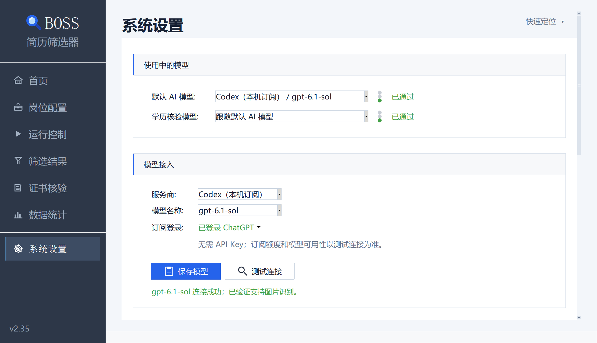
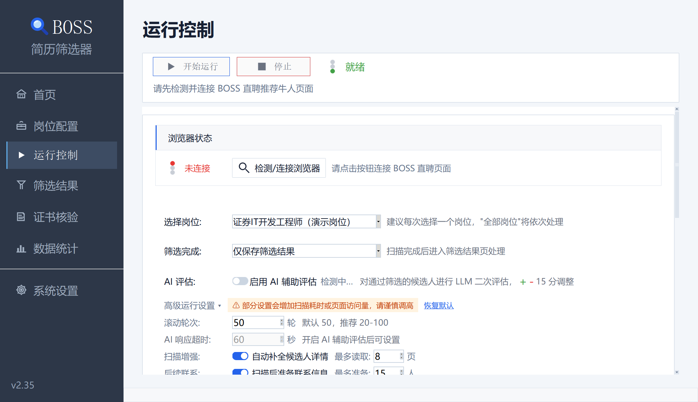

# BOSS 简历筛选器 — 安装使用说明

适用版本：v2.35。普通用户运行安装包不需要 Python。使用 Codex 本机订阅时，需额外安装官方 Codex CLI；使用其他 API 服务不需要安装 Codex。

## 1. 下载与安装

从 [GitHub 最新版本](https://github.com/yaoyouzhong/boss-resume-filter/releases/latest) 或 [Gitee 国内镜像](https://gitee.com/yaoyouzhong/boss-resume-filter/releases) 下载，不要下载源码 ZIP 代替程序。

| 使用场景 | 文件 | 安装方式 |
| --- | --- | --- |
| Windows 招聘工作台 | BOSS_ResumeFilter.exe | 放入当前用户可写的独立文件夹，双击启动 |
| Windows 仅核验证书 | EducationCertificateTool.exe | 放入独立文件夹，双击进入模型配置 |
| macOS 招聘工作台 | BOSS_ResumeFilter.dmg | 打开后将 App 拖入 Applications，再从 Applications 启动 |

首次运行会自动生成所需默认配置，不必额外复制 README 或配置模板。Windows 程序目录会保存业务配置和数据，后续升级请保留该目录。macOS 不要直接从 DMG 内长期运行；首次启动按系统提示打开，公司受管电脑按管理员要求处理。

读取 BOSS 推荐候选人或打开学信网需要 Chrome。离线导入简历、规则筛选和数据查看不需要连接 BOSS。

## 2. 选择模型接入方式

只做规则筛选时可以跳过模型配置。使用 AI 增强、简历评估或证书识别时，在“系统设置”配置；独立证书核验助手在“模型配置”中操作。

### 使用 Codex 本机订阅

1. 按 [OpenAI 官方 Codex CLI 安装说明](https://learn.chatgpt.com/docs/codex/cli) 在当前操作系统安装官方 CLI。已安装时可在终端运行 `codex --version` 确认可找到程序；安装完成后重新打开 BOSS。
2. 服务商选择“Codex（本机订阅）”，无需填写 API Key 和 Base URL。
3. 点击订阅登录状态，选择“登录 ChatGPT”，在浏览器中由本人完成登录。已有登录时选择“刷新状态与模型”。也可按[官方登录说明](https://learn.chatgpt.com/docs/auth)运行 `codex login`，再回程序刷新。
4. 从模型列表选择模型，点击“保存模型”。列表来自本机缓存，并非账号授权清单；不要仅凭模型名称判断可用性。
5. 在“使用中的模型”选择默认 AI 模型。证书识别可另选学历核验模型，或保持“跟随默认 AI 模型”。
6. 点击“测试连接”。顶部信号灯和已保存模型列表同步显示结果；按钮下方分别说明连接和图片能力。

测试会发送程序生成的数字图片，不使用你的简历或证书。Codex 测试最长等待约 120 秒；“连接成功、图片能力尚未确认”不能视为证书图片识别通过。CLI 不兼容时程序会提示更新，额度、网络或模型不可用时不会自动切换其他服务。

BOSS 与独立证书核验助手共用当前系统用户的官方 CLI 登录，分别保存模型和截图偏好；在其他电脑或其他系统用户下仍需重新登录。程序不读取或复制登录令牌。仅安装桌面应用，不代表本机 CLI 一定能被找到。

### 使用 API 服务

1. 选择服务商，例如通义千问、DeepSeek、Kimi、OpenAI、Anthropic；其他接入方式选择“自定义”。
2. 输入服务商提供的 Base URL 和 API Key，获取或填写当前账号已开通的模型名称。
3. 点击“保存模型”，再选择默认 AI 模型和可选的学历核验模型。
4. 点击“测试连接”，需要识别图片时确认已验证图片能力。

API Key 保存在当前用户的系统安全凭据中，配置文件不保存明文 Key。复制配置文件不会迁移 API Key；新电脑需重新输入。Codex 订阅与 API 是两种独立接入方式，API 费用和可用范围以服务商账号为准。

## 3. 完成第一次筛选

1. 打开“岗位配置”，新建岗位，粘贴招聘需求并解析，核对学历、经验、薪资、地点和技能权重后保存。
2. 按程序提示连接 Chrome，在浏览器中由本人登录 BOSS，并确认进入对应岗位的推荐候选人页面。
3. 在“运行控制”选择岗位和扫描范围；按需要开启 AI 辅助评估。开始、停止和运行状态固定在页面上方，滚动日志时仍可操作。
4. 进入“筛选结果”核对评分依据和待复核记录。需要联系的人先加入联系清单，人工确认后再发送。
5. 在“数据统计”查看岗位成效，合适率和误推率结合有效反馈样本判断。

外部简历可从“筛选结果”导入，无需在 BOSS 定位对应人。外部导入的 AI 画像增强和简历评估分别由用户开启。完整流程见[图文操作说明](docs/BOSS招聘系统操作说明-图文版.md)。

## 4. 使用学历与学位核验

在“证书核验”或独立核验助手中导入图片或 PDF，核对姓名、编号和证书类型，再打开学信网。扫码和最终结果确认由本人完成；支持分批补交，最后保存结果截图。只处理证书的用户可直接使用独立助手，不必先配置招聘岗位或登录 BOSS。

详见[独立核验助手操作说明](docs/education-tool-manual.md)。

## 5. 升级、备份与换机

- 主程序会检查新版本，在首页显示升级入口；下载完成后需本人确认安装。开启空闲自动下载也不会自动安装。
- 升级前可在“系统设置”导出统一备份，包含岗位、候选人、联系清单和受管简历。备份 ZIP 不加密，请保存到受控位置。
- 保留程序目录中的业务数据及配置。不要把本机数据、API Key 或 Chrome 登录资料提交到 Git。
- 换机后从程序内恢复备份，API 服务重新输入 Key，Codex 重新安装 CLI 并登录；独立核验助手的模型和截图偏好需另行配置。

## 6. 常见问题

| 现象 | 处理方法 |
| --- | --- |
| 提示未安装 Codex CLI | 确认安装在程序所在的系统和当前用户环境；能运行 `codex --version` 后重新打开程序 |
| Codex 提示更新或登录失效 | 按官方说明更新 CLI，重新登录 ChatGPT，再刷新状态和模型 |
| 登录成功但连接失败 | 检查网络、账号额度及所选模型权限，实际调用成功才代表当前可用 |
| 连接成功但图片未验证 | 查看下方图片能力说明，重新测试或另选支持图片输入的模型 |
| 列表中的状态未检测 | 先测试对应连接；状态按服务商、地址和模型区分，不会套用给其他模型 |
| 新电脑缺少 API Key | 在该电脑重新填写并保存，不能靠复制配置文件迁移系统凭据 |
| 扫描前浏览器未就绪 | 确认 Chrome 已连接、BOSS 已登录，且页面与所选岗位对应 |

继续排查请参考[图文操作说明中的常见问题](docs/BOSS招聘系统操作说明-图文版.md#十四常见问题处理)。
